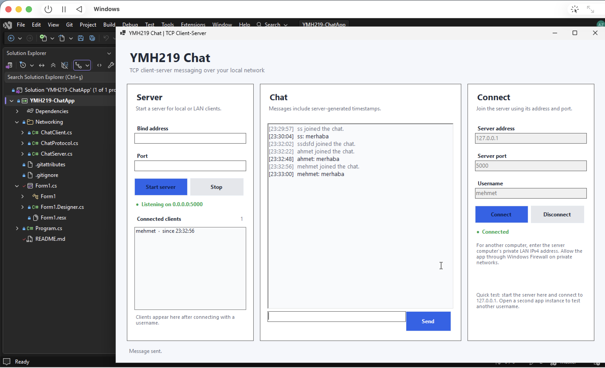
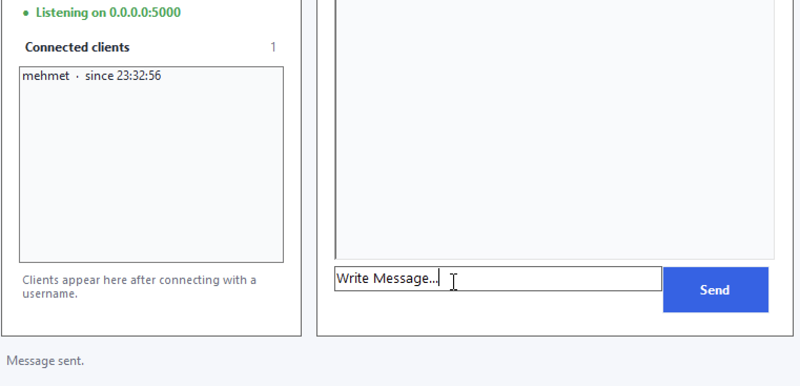
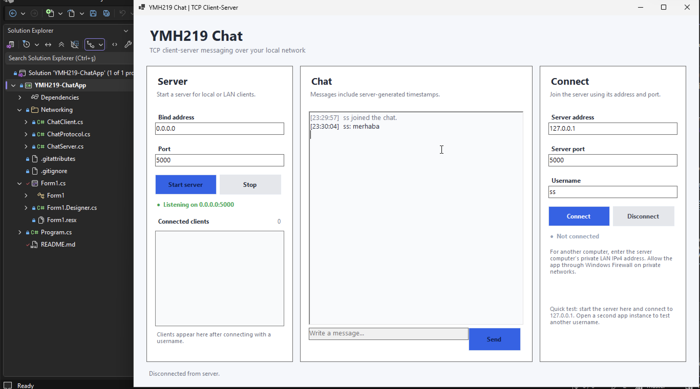

# 💬 YMH219 - ChatApp


**Nesne Tabanlı Programlama (YMH 219)** dersi kapsamında **C#** ve **.NET 10 Windows Forms** kullanılarak geliştirilen, TCP tabanlı istemci-sunucu (client-server) masaüstü sohbet uygulamasıdır.

## 📸 Ekran Görüntüleri

### start server


### message user interface


### main menu



Bir uygulama örneği hem sunucu (server) olarak hizmet verebilir hem de istemci (client) olarak sohbete katılabilir. Aynı bilgisayardaki veya yerel ağdaki (LAN) diğer uygulama örnekleri, bir kullanıcı adı seçerek sunucuya bağlanabilir ve sunucu tarafından oluşturulan zaman damgalarıyla anlık mesajlaşabilir.

---

## 🛠️ Kullanılan Teknolojiler ve NuGet Paketleri

* **Programlama Dili:** C#
* **Platform & Framework:** .NET 10 (`net10.0-windows`) / Windows Forms (WinForms)
* **Ağ İletişimi (TCP):** `TcpListener` ve `TcpClient`
* **Veri Akışı ve Protokol:** `NetworkStream`, `StreamReader` ve `StreamWriter` (yeni satırla ayrılmış UTF-8 JSON mesajları)
* **Asenkron Programlama:** Ağ işlemleri ve güvenli kapatma için `async`/`await` ve iptal mekanizması (`CancellationToken`)
* **Geliştirme Ortamı (IDE):** Visual Studio 2026
* **Sürüm Kontrolü:** Git & GitHub
* **NuGet Paketleri:** Harici bir NuGet paketi kullanılmamıştır. Proje tamamen standart .NET 10 ve Windows Forms kütüphaneleri ile geliştirilmiştir.

---

## 🚀 Kurulum ve Çalıştırma Adımları

### Gereksinimler
* Windows işletim sistemi.
* Projeyi derlemek için **.NET 10 SDK** (veya derlenmiş sürümü çalıştırmak için **.NET 10 Desktop Runtime**).
* Yerel ağ (LAN) kullanımı için bilgisayarların birbirine erişebilir aynı ağa bağlı olması gerekir.

### 1. Depoyu Klonlayın
```bash
git clone [https://github.com/azekra/YMH219-ChatApp.git](https://github.com/azekra/YMH219-ChatApp.git)
```

### 2. Yerel Olarak Çalıştırma (Localhost)
1. `YMH219-ChatApp.slnx` dosyasını **Visual Studio 2026** ile açın ve projeyi derleyip çalıştırın. Alternatif olarak proje dizininde PowerShell açıp şu komutu çalıştırabilirsiniz:
   ```powershell
   dotnet run --project .\YMH219-ChatApp.csproj
   ```
2. **Server** kartında bağlama adresini (bind address) `0.0.0.0`, portu `5000` olarak bırakın ve **Start server** butonuna tıklayın.
3. **Connect** kartında sunucu adresini `127.0.0.1`, portu `5000` olarak bırakın, bir kullanıcı adı girin ve **Connect** butonuna tıklayın.
4. İki istemci arasında mesajlaşmayı test etmek için ikinci bir uygulama örneği açın ve farklı bir kullanıcı adı ile `127.0.0.1:5000` adresine bağlanın.

### 3. Yerel Ağ (LAN) Üzerinde Çalıştırma
1. Sohbete ev sahipliği yapacak bilgisayarda sunucuyu başlatın. Ağ arayüzlerinden gelen bağlantıları kabul edebilmesi için bağlama adresi `0.0.0.0` olmalıdır.
2. Windows Güvenlik Duvarı (Firewall) uyarısı çıkarsa uygulamaya **Özel (Private)** ağlarda izin verin. Gerekirse seçilen TCP portu için gelen (inbound) güvenlik duvarı kuralı oluşturun.
3. Sunucu bilgisayarının yerel IPv4 adresini öğrenin (örneğin komut isteminde `ipconfig` komutu ile).
4. Diğer bilgisayarlarda uygulamayı çalıştırın; **Connect** kartına sunucunun yerel IPv4 adresini, port numarasını ve benzersiz bir kullanıcı adını girerek bağlanın.
5. İstemciler mesajlaşırken sunucu uygulamasını açık ve sunucuyu çalışır durumda tutun.

---

## ✨ Uygulamanın Temel Özellikleri

* **Sunucu Yönetimi:** Uygulama üzerinden TCP sunucusunu başlatma ve durdurma.
* **İstemci Bağlantısı:** IP adresi, port numarası ve kullanıcı adı ile sunucuya bağlanma.
* **Zaman Damgalı Mesajlaşma:** Sunucu tarafından oluşturulan zaman damgalarıyla anlık mesaj gönderme ve alma.
* **Bağlı İstemci Takibi:** Sunucu ekranında bağlı kullanıcı adlarını ve bağlantı zamanlarını görüntüleme.
* **Hata Yönetimi:** Bağlantı ve ağ hatalarını uygulamayı kapatmadan kullanıcıya bildirme.
* **Çoklu İstemci Desteği:** Birden fazla istemcinin aynı anda bağlanıp mesajlaşabilmesi.

### 🧱 Proje Yapısı

| Dosya | Açıklama |
|---|---|
| `Form1.cs` | Ana panel (dashboard) düzeni ve kullanıcı arayüzü olay yönetimi. |
| `Networking/ChatServer.cs` | Asenkron TCP sunucusu ve bağlı istemcilerin yönetimi. |
| `Networking/ChatClient.cs` | Asenkron TCP istemci işlemleri. |
| `Networking/ChatProtocol.cs` | İstemci ve sunucu arasındaki ortak JSON mesaj protokolü tanımlamaları. |

---

## 📝 Bilinen Sınırlamalar ve Geliştirme Notları

* **Güvenlik ve Ağ Kapsamı:** Bu proje yerel ağ (LAN) üzerinde çalışmak üzere tasarlanmış bir ders ödevidir. Şifreleme (encryption), hesap doğrulama (authentication) veya güvenilmeyen ağ trafiğine karşı koruma sağlamaz. Doğrudan genel internete (public internet) açılmamalıdır.
* **Varsayılan Port:** Varsayılan port `5000`'dir. Eğer bu port sistemde başka bir uygulama tarafından kullanılıyorsa, kullanılabilir başka bir port seçilmeli ve tüm istemcilerde aynı port değeri girilmelidir.
* **Platform Bağımlılığı:** `.NET 10` Windows Forms (`net10.0-windows`) kullanıldığı için uygulama yalnızca Windows işletim sisteminde çalışmaktadır.

---

## 👨‍💻 Geliştirici Bilgileri

* **Ad Soyad:** [Enes Zukra]
* **Öğrenci Numarası:** [250541616]
